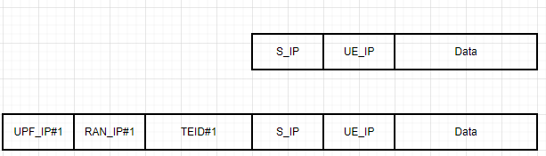
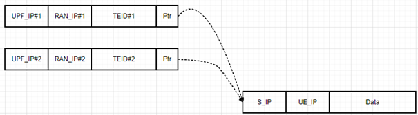

# ĐỀ TÀI SÁNG KIẾN Ý TƯỞNG: TỐI ƯU HÓA XỬ LÝ GÓI TIN HIỆU NĂNG CAO BẰNG KỸ THUẬT ZERO-COPY TRÊN NỀN TẢNG DPDK

* **Tên sáng kiến:** Ứng dụng kỹ thuật Zero-Copy (Chained-mbuf) để nhân bản gói tin trong tính năng Redundant Transmission trên giao diện N3/N9 của 5G UPF
* **Lĩnh vực:** Software Engineering (SE) – High Performance Computing (HPC) / Viễn thông 5G Core
* **Use Case:** Tính năng **Redundant Transmission trên giao diện N3/N9** (cho luồng dịch vụ URLLC)

---

## 📌 1. TỔNG QUAN Ý TƯỞNG (EXECUTIVE SUMMARY)

Kỹ thuật **Zero-Copy** đề xuất giải quyết bài toán nhân bản (duplicate) bản tin trong môi trường mạng hiệu năng cao mà **không cần sao chép (copy) phần payload dữ liệu**. Giải pháp tận dụng cơ chế **Chained-mbuf** của thư viện DPDK (Data Plane Development Kit) và phần cứng Card mạng (NIC), giúp:
* Loại bỏ chi phí CPU copy bộ nhớ (memory copy) cho payload.
* Giảm thiểu hiện tượng **Cache Miss** của CPU.
* Đảm bảo chỉ tiêu khắt khe về độ trễ (latency) và thông lượng (throughput) cho các dịch vụ 5G độ tin cậy cao và độ trễ siêu thấp (**URLLC**).

---

## 🎯 2. BỐI CẢNH & ĐẶT VẤN ĐỀ (PROBLEM STATEMENT)

### 2.1. Bối cảnh kỹ thuật
* Trong kiến trúc 5G Core, **UPF (User Plane Function)** chịu trách nhiệm xử lý và định tuyến lưu lượng người dùng ở tốc độ rất cao (hàng chục đến hàng trăm Gbps).
* Gói tin nhận từ mạng dữ liệu (Data Network / Server) đến UPF được lưu trữ trong cấu trúc dữ liệu bộ nhớ của DPDK gọi là **`mbuf`** (`rte_mbuf`).
* Để chuyển tiếp gói tin đến trạm gốc (gNodeB / gNB), UPF cần lấy thêm thông tin định tuyến của trạm để chèn thêm một lớp vỏ bên ngoài (**Outer Layer Header**: IPv4/IPv6, UDP, GTP-U header chứa TEID).


*Hình 1: Luồng đóng gói Outer Header vào gói tin gốc trước khi gửi ra trạm gốc (gNB)*

### 2.2. Điểm nghẽn ở luồng dịch vụ URLLC (Redundant Transmission on N3/N9)
* Với các dịch vụ **URLLC (Ultra-Reliable Low-Latency Communication)**, để đảm bảo độ tin cậy gần như tuyệt đối (99.999%), mạng 5G triển khai tính năng **Redundant Transmission**: Một gói tin từ UPF cần được **nhân bản (duplicate)** thành 2 luồng độc lập gửi qua các đường truyền khác nhau đến gNB.
* Kích thước trung bình của gói tin payload dữ liệu là khoảng **800 bytes** (hoặc lớn hơn theo MTU).


*Hình 2: Yêu cầu nhân bản gói tin gửi ra trạm gốc cho luồng URLLC*

---

## ⚠️ 3. HẠN CHẾ CỦA PHƯƠNG PHÁP TRUYỀN THỐNG

| Tiêu chí | Phương pháp truyền thống (Deep Copy) | Ảnh hưởng hiệu năng |
| :--- | :--- | :--- |
| **Xử lý chèn Header gốc** | Chép trực tiếp header vào gói tin gốc (~64 bytes). | Làm tăng gấp đôi chi phí xử lý gói tin cơ bản. |
| **Nhân bản gói tin (Duplicate)** | Cấp phát `mbuf` mới và sao chép toàn bộ dữ liệu (cả Header lẫn Data payload ~800 bytes). | Tiêu tốn chu kỳ CPU rất lớn cho thao tác `memcpy`. |
| **Tương tác bộ nhớ (Memory Access)** | Đọc/ghi toàn bộ vùng Data từ RAM lên Cache của CPU. | **CPU Cache Miss** tăng vọt. UPF bình thường chỉ cần đọc header; việc chạm vào Data buộc CPU phải kéo dữ liệu từ RAM lên L1/L2/L3 Cache, gây tắc nghẽn bus bộ nhớ. |
| **Hệ quả** | Không thể đáp ứng chỉ tiêu SLA nghiêm ngặt về độ trễ cực thấp (< 1ms) và thông lượng cao của chuẩn 5G URLLC. |

---

## 💡 4. GIẢI PHÁP ĐỀ XUẤT: KỸ THUẬT ZERO-COPY VỚI CHAINED-MBUF

### 4.1. Nguyên lý cốt lõi
Phần lớn các bộ điều khiển mạng (NIC) hỗ trợ DPDK hiện nay đều có tính năng **Scatter-Gather I/O** (cho phép truyền một gói tin nằm rải rác trên nhiều vùng bộ nhớ liên kết với nhau, gọi là **Chained-mbuf**).

Thay vì gom tất cả Header và Data vào một `mbuf` duy nhất bằng lệnh copy:
1. **Tạo trước Header mbuf:** Khởi tạo các `mbuf` nhỏ chỉ chứa thông tin **Outer Header** (IP, UDP, GTP-U TEID,... ứng với từng trạm gốc / từng đường truyền).
2. **Tham chiếu Data Payload (Zero-Copy):**
   * Giữ nguyên `mbuf` gốc chứa Data Payload nhận từ Server.
   * Tăng bộ đếm tham chiếu (`rte_pktmbuf_refcnt_update`) của `mbuf` gốc.
3. **Liên kết Chained-mbuf:**
   * Gán con trỏ `next` của Header `mbuf` trỏ tới `mbuf` chứa Data Payload gốc.
   * Cả 2 bản tin nhân bản đều chia sẻ chung một vùng nhớ Data Payload gốc mà **không cần copy một byte dữ liệu payload nào**.
4. **Phần cứng NIC tự ghép:** Card mạng DPDK sẽ tự động đọc chuỗi `mbuf` và đẩy ra đường truyền vật lý như một gói tin hoàn chỉnh.

### 4.2. Sơ đồ kiến trúc giải pháp

```text
+-------------------------------------------------------------------------+
|                              SERVER DATA                                |
|                   +----------------------------------+                  |
|                   |       Payload Data (800B)        |                  |
|                   +----------------------------------+                  |
+-------------------------------------|-----------------------------------+
                                      | (Zero-Copy - Shared Reference)
                +---------------------+---------------------+
                |                                           |
+---------------v---------------+           +---------------v---------------+
|          BẢN TIN 1            |           |          BẢN TIN 2            |
|  [Header mbuf 1 (Path 1)]     |           |  [Header mbuf 2 (Path 2)]     |
|   (TEID_A, IP_gNB1, UDP)      |           |   (TEID_B, IP_gNB2, UDP)      |
|               | (chain/next)  |           |               | (chain/next)  |
|               v               |           |               v               |
|      [Shared Data mbuf]       |           |      [Shared Data mbuf]       |
|       (Payload 800 bytes)     |           |       (Payload 800 bytes)     |
+-------------------------------+           +-------------------------------+
```

---

## 📊 5. HIỆU QUẢ VÀ GIÁ TRỊ MANG LẠI

1. **Triệt tiêu chi phí Memory Copy (Zero Memory Copy):**
   * Tiết kiệm hoàn toàn chi phí copy trung bình **800 bytes / gói tin** nhân bản.
2. **Tối ưu hóa CPU Cache & Chu kỳ lệnh:**
   * CPU của UPF chỉ xử lý và ghi đè trên vùng nhớ Header nhỏ (khoảng 64 bytes) đã nằm sẵn trong L1 Cache, không chạm vào vùng Data payload trong RAM.
   * Giảm tối đa hiện tượng **Cache Line Invalidation** và **RAM access latency**.
3. **Nâng cao năng lực xử lý (Throughput & Latency):**
   * Đảm bảo thông lượng chuyển tiếp (PPS - Packets Per Second) duy trì ở mức tối đa trên giao diện N3/N9.
   * Giữ độ trễ ổn định mức microsecond ($\mu s$), đáp ứng hoàn hảo tiêu chuẩn quốc tế 3GPP cho luồng 5G URLLC.

---

## 🛠️ 6. KẾ HOẠCH TRIỂN KHAI & ĐÁNH GIÁ (ROADMAP)

* **Bước 1:** Phân tích cấu trúc `rte_mbuf` và API Chained-mbuf trong DPDK (`rte_pktmbuf_chain`, `rte_pktmbuf_attach`).
* **Bước 2:** Hiện thực hóa logic tạo Outer Header riêng biệt và liên kết với Data Payload gốc trong module UPF N3/N9 Redundant Transmission.
* **Bước 3:** Đo kiểm Benchmark so sánh giữa phương pháp Deep Copy truyền thống và Zero-Copy:
  * Số chu kỳ CPU tiêu tốn trên mỗi gói tin (CPU cycles/packet).
  * Tỷ lệ Cache Miss (L1/L2/LLC cache misses thông qua `perf`).
  * Thông lượng tối đa (Throughput - Mpps) và Độ trễ (Latency profile).